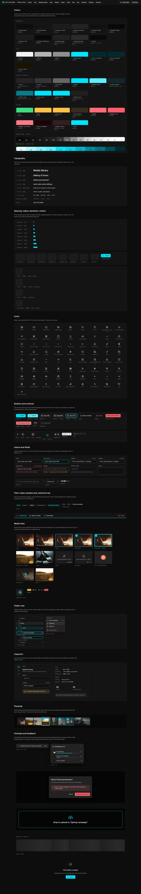

# Design system — "Neutral + neon"

The visual language of the wp-upload media manager. It is the "Neutral + neon" direction chosen at
Checkpoint 1 ([directions.md](directions.md)), with Pro tool's neutral selection cell and borderless
chips, plus the shared fixes the three directions asked for.

**Source of truth** is the code, not this document:

| File | What it holds |
|---|---|
| [`prototype/css/tokens.css`](prototype/css/tokens.css) | Every token: primitives and semantic, both themes |
| [`prototype/css/components.css`](prototype/css/components.css) | Every component and state |
| [`prototype/system.html`](prototype/system.html) | The living reference page; open via `serve.mjs`, `?theme=light` for the light theme |

## 1. Principles

1. **Images are the colour.** The chrome is achromatic. Every surface that touches imagery (app
   background, stage, tile, filmstrip) has zero chroma; this is measured by `scripts/token-report.mjs`.
2. **Cyan is a signal, not decoration.** It is used only for focus, selection, the primary action,
   active navigation (current folder, active inspector tab, active filter) and the brand mark.
   - Toggle states such as layout, panel visibility and pressed toolbar buttons are neutral.
3. **Quiet at rest, rich on intent.** Tiles show only the image. Hover reveals the check circle and the
   file name. Selection and focus are strong, distinct rings.
4. **One accent per theme, AA everywhere.** Dark uses the bright neon `#00e5ff`. Light splits it into a
   bright fill (`#00d4ec`) and a deeper teal (`#008a9e` / `#007485`) for text and rings, so both pass AA.
5. **Mono for machine values.** Counts, dimensions, sizes, indexes (`12 / 93`), keyboard hints and the
   small section labels use Geist Mono with tabular figures.

## 2. Colour

### Primitives

These are never used by components directly.

| Scale | Steps (dark → light) |
|---|---|
| Grey | `--gray-1000 #080808` · `950 #0d0d0d` · `925 #101010` · `900 #141414` · `850 #1c1c1c` · `800 #222` · `700 #333` · `600 #666` · `500 #8f8f8f` · `400 #b3b3b3` · `300 #d4d4d4` · `200 #e6e6e6` · `150 #ebebeb` · `100 #f4f4f4` · `50 #fafafa` · `0 #fff` |
| Neon cyan | `--cyan-50 #e6fdff` · `100 #b3f8ff` · `200 #80f3ff` · `300 #5cefff` · `400 #00e5ff` · `500 #00d4ec` · `600 #00b4cc` · `700 #008a9e` · `800 #007485` · `900 #004c57` · `950 #002a30` |

### Semantic tokens

| Token | Dark | Light | Use |
|---|---|---|---|
| `--surface-app` | gray-950 | gray-100 | App background, grid gaps |
| `--surface-panel` | gray-900 | white | Toolbar, folder column, inspector |
| `--surface-raised` | gray-850 | white | Buttons, cards |
| `--surface-overlay` | gray-800 | white | Menus, dialogs, toasts, tray |
| `--surface-input` | gray-925 | white | Inputs |
| `--surface-stage` | gray-1000 | gray-150 | Detail-mode stage, preview wells |
| `--surface-tile` | gray-850 | gray-200 | Tile placeholder before the image loads |
| `--surface-filmstrip` | gray-1000 | gray-50 | Filmstrip tray |
| `--surface-hover` / `--surface-active` | white 6 % / 10 % | black 4.5 % / 8 % | Hover and pressed overlays |
| `--scrim` | black 60 % | black 35 % | Behind dialogs and the drop overlay |
| `--text-1` / `--text-2` / `--text-3` | `#f2f2f2` / gray-400 / gray-500 | `#111` / `#4a4a4a` / `#6b6b6b` | Primary / secondary / tertiary text |
| `--text-accent` | cyan-400 | cyan-800 | Active labels, selection count, toast action |
| `--text-on-accent` | cyan-950 | `#00262b` | Text on the primary button |
| `--text-on-select` | cyan-950 | white | Check glyph on the selection badge |
| `--line-1` / `--line-2` | white 7 % / 14 % | black 8 % / 15 % | Dividers / control borders |
| `--line-input` | gray-600 | `#8a8a8a` | Input and select edges (≥ 3:1) |
| `--accent` / `--accent-hover` | cyan-400 / cyan-300 | cyan-500 / `#00c2da` | Primary fill |
| `--accent-subtle` / `--accent-line` | cyan 10 % / 50 % | cyan 10 % / teal 45 % | Active backgrounds, focus halo |
| `--focus-ring` / `--select-ring` | cyan-400 | cyan-700 | Keyboard focus / selection rings |
| `--select-tint` | white 5 % | black 4 % | Neutral cell behind a selected image |
| `--ok` / `--warn` / `--danger` / `--info` | `#3ddc84` / `#ffc247` / `#ff6b78` / cyan-400 | `#17803d` / `#a86400` / `#c8283a` / cyan-800 | Status text and icons |
| `--danger-fill` / `--danger-fill-hover` / `--text-on-danger` | `#ff5c6c` / `#ff7a86` / `#1f0004` | `#c8283a` / `#a61f2f` / white | Destructive buttons ("Delete permanently"), failed badge |
| `--warn-fill` / `--text-on-warn` | `#ffc247` / `#1a1300` | same | The "Alt" badge |
| `--warn-subtle` / `--danger-subtle` | tinted 14 % | tinted 8–10 % | Notice backgrounds |
| `--filmstrip-dim` | 0.55 | 0.72 | Opacity of non-current filmstrip cells |

### Measured contrast and neutrality

From `scripts/token-report.mjs`. All rows pass. The selection check glyph is a graphic, so 3:1 applies.
In addition, `scripts/screenshots.mjs` hovers every button, chip and menu item on the reference page
in both themes and checks the text against the background actually painted (≥ 4.5:1).

| Pair | Minimum | Dark | Light |
|---|---|---|---|
| `--surface-stage` / `-tile` / `-app` / `-filmstrip` chroma | ≤ 0.010 | 0.000 | 0.000 |
| `--text-1` on `--surface-panel` | 4.5 | 16.46 | 18.88 |
| `--text-2` on `--surface-panel` | 4.5 | 8.79 | 8.86 |
| `--text-3` on `--surface-panel` / `-app` / `-overlay` | 4.5 | 5.70 / 6.01 / 4.92 | 5.33 / 4.85 / 5.33 |
| `--text-accent` on `--surface-panel` | 4.5 | 11.98 | 5.47 |
| `--text-on-accent` on `--accent` | 4.5 | 9.94 | 8.86 |
| `--text-on-select` on `--select-ring` | 3 | 9.94 | 4.09 |
| `--text-on-warn` on `--warn-fill` | 4.5 | 11.49 | 11.49 |
| `--text-on-danger` on `--danger-fill` / `-hover` | 4.5 | 6.60 / 7.91 | 5.50 / 7.35 |
| `--text-on-accent` on `--accent-hover` | 4.5 | 11.10 | 7.41 |
| `--warn` / `--danger` / `--ok` on `--surface-panel` | 4.5 | 11.46 / 6.69 / 10.32 | 4.68 / 5.50 / 5.01 |
| `--focus-ring` on `--surface-app` / `-panel` | 3 | 12.63 / 11.98 | 3.72 / 4.09 |
| `--select-ring` on `--surface-tile` | 3 | 11.08 | 3.28 |
| `--line-input` on `--surface-input` / `-panel` | 3 | 3.31 / 3.21 | 3.45 / 3.45 |

## 3. Typography

| Token | Value | Use |
|---|---|---|
| `--font-ui` | Geist 400/500/600 | Everything by default |
| `--font-mono` / `--font-display` | Geist Mono 500 | Counts, sizes, dimensions, `kbd`, small uppercase section labels |
| `--font-brand` | Orbitron 600 | The wordmark only |
| `--fs-11 … --fs-24` | 11 / 12 / 13 / 14 / 16 / 20 / 24 px | 13 px is body; 12 px is labels and chips; 11 px is mono meta |
| `--display-transform` / `--display-tracking` | uppercase / 0.1em | Section and panel titles ("FOLDERS", "INFO", "FILE") |

**Rules:**

- Sentence case everywhere except display labels.
- File names are truncated in the middle so the extension stays visible.
- Numbers use tabular figures.
- **Production should self-host the fonts.** The prototype loads them from Google Fonts.

## 4. Space, shape, elevation, motion, layers

| Group | Tokens |
|---|---|
| Spacing (4 px grid) | `--space-1…8` = 4, 8, 12, 16, 20, 24, 32, 40 px. Grid gap `--grid-gap: 2px`; panel padding 16–24 px |
| Radius | `--radius-xs 4` · `sm 6` (controls) · `md 10` (cards, menus) · `lg 14` (dialogs, tray) · `pill`. Tiles `--radius-tile 2`; a selected image rounds to `--radius-tile-selected 8` and scales to `--tile-selected-scale 0.9` |
| Elevation | `--shadow-1` (subtle), `--shadow-2` (menus, toasts), `--shadow-3` (dialogs, drawers, tray). `--glow-accent` is used only on the primary button and the selection check |
| Motion | `--dur-1 90ms` (fades, hovers) · `--dur-2 150ms` (panels, selection) · `--dur-3 220ms` (overlays) · `--dur-morph 260ms` (grid↔detail). Easing: `--ease-out` on enter, `--ease-in` on exit, `--ease-standard` for state changes |
| Reduced motion | `--dur-2` and `--dur-morph` drop to 1 ms; fades stay; the grid↔detail morph becomes a cross-fade; skeleton shimmer stops |
| Layers | `--z-grid 0` · `--z-detail 2` · `--z-toolbar 3` · `--z-drawer 10` · `--z-popover 20` · `--z-toast 30` · `--z-dialog 40` · `--z-drop-overlay 45` |

**Layout dimensions** are fixed by the brief, in `base.css`: toolbar 48 px, filter bar 40 px, folder
column 280 px (drag 220–480), inspector rail 48 + panel 312 px, filmstrip 96 px.

## 5. Icons

[Tabler Icons](https://tabler.io/icons), outline set, MIT licence:

- **Size and stroke:** 18 px by default (`.icon`), 14 px small, 24 px large, with a 1.75 stroke.
- **Colour:** icons inherit `currentColor`.
- **The prototype's set:** 72 icons in `prototype/icons.svg`, all listed on the reference page.
- **Production:** `@tabler/icons-react` gives the same glyphs.

## 6. Components

All of them are in `components.css` and shown on `system.html`. States marked † are added by JS.

| Component | Anatomy and states | Notes |
|---|---|---|
| **Brand** | SVG viewfinder mark + Orbitron wordmark | The only place Orbitron is used |
| **Button** | default, `--primary`, `--ghost`, `--danger`, `--danger-solid`, `--sm`; hover, focus, disabled | One primary per view. Focus = 2 px ring + 4 px subtle halo |
| **Icon button** | rest, hover, pressed (neutral), rail-active (accent), disabled | Always has a tooltip with its shortcut |
| **Segmented** | raised thumb on a hover-tone track | Layout toggle (justified/square), later the stage background |
| **Input / textarea / select** | rest, hover, focus (focus-ring border + halo), warn, error, mixed (dashed, italic placeholder) | Edges use `--line-input` (≥ 3:1) |
| **Field** | label row with autosave status (Saving…, Saved ✓, Not saved), control, hint | Autosaves on blur and Ctrl/Cmd+Enter; there are no Save buttons |
| **Chip** | borderless toggle; active = accent-subtle + accent text; optional count; removable | Filter row above the grid |
| **Toolbar / selection bar** | the toolbar becomes the selection bar at ≥ 2 selected: accent underline, accent count | Actions: Move to folder, Edit details, Download, Delete |
| **Breadcrumb** | folder path, last segment emphasised | |
| **Folder tree row** | rest, hover, current (accent tint + 2 px leading bar), drop target (accent ring), inline rename (input), Pro colour (`--folder-color`) | Counts in mono. Colours only with FileBird Pro |
| **Media tile** | rest, hover (scrim, check circle, name), focus (ring), selected (image scales into a neon ring, neutral cell, check), selected + focus (double ring), badges (Alt, duration, pages), non-image card, SVG checkerboard, uploading (progress ring), error (danger ring), returning† (accent ring fades out) | Rings are drawn by `::after` *above* the image, so they show on full-bleed photos |
| **Badge** | neutral translucent, `--warn` (Alt), `--danger` | On tiles, bottom right |
| **Progress ring** | conic gradient, `--progress` 0–1 | Uploading tiles |
| **Inspector** | icon rail (Info / Edit / Usage) + one panel; summary (none), fields (one), batch with Mixed (many); meta lists, stats, notices | Rail tab = accent; collapses to the rail |
| **Notice** | neutral, warn, danger | Inline, inside panels and dialogs |
| **Detail bar, stage, filmstrip** | stage on `--surface-stage`; hover-revealed prev/next; filmstrip: dimmed neighbours, **current = neutral outline outside the cell**, **selected = neon ring + check**; both can show at once | Play overlay for video |
| **Menu** | label, items with icon and `kbd`, hover/active, separator, danger item | Context menus, sort menu |
| **Tooltip** | inverted (text-1 background), with `kbd` | |
| **Dialog** | scrim, title, text, optional notice, actions (cancel + primary/danger) | Only for permanent or destructive actions |
| **Toast** | icon, text, action (Undo) | For reversible actions; bottom centre |
| **Upload tray** | header with count and collapse; rows with thumb, name, progress bar or done/error icon | Bottom right |
| **Drop overlay** | full-window scrim with a dashed accent target and its destination ("Drop to upload to …") | |
| **Skeleton / empty state** | shimmer in content shape; empty = dashed art, title, text, one action | No spinners in content areas |

### Changes made while promoting the direction

These are the shared fixes requested in Stage 2. They are now part of the system, not skin overrides:

- **Warnings:** `--warn` is split into `--warn` (text) + `--warn-fill` + `--text-on-warn`.
- **Danger, from the Checkpoint 2 review:**
  - destructive buttons get `--danger-fill`, `--danger-fill-hover` and `--text-on-danger`;
  - hovering "Delete permanently" no longer turns white-on-white in light, and dark uses dark text
    on the red (white was 3:1);
  - dark `--danger` text is lifted to `#ff6b78`, so hovered menu items stay ≥ 4.5:1.
- **Inputs:** focus border uses `--focus-ring`; field edges use the new `--line-input`.
- **Filmstrip:**
  - "current" is a neutral outline and "selected" an inner neon ring, and both can show at once;
  - the tray has its own `--surface-filmstrip` and `--filmstrip-dim`.
- **Brand:** a dedicated wordmark element and an SVG mark.
- **Tile rings:** they moved above the image (fixing focus and error rings that were hidden behind
  full-bleed photos).
- **From Pro tool:** borderless chips, and a neutral selection cell with no cyan glow behind a photo.

## 7. Accessibility rules

- **Contrast:** text ≥ 4.5:1; focus rings, selection rings and field edges ≥ 3:1; both themes measured
  (§2).
- **Focus:** keyboard focus is always visible and distinct from selection.
- **Colour is never the only signal:** selection also has a check, warnings an icon, the current folder
  a leading bar.
- **Announcements:** state changes (selection count, mode switches, saves) go through one polite live
  region.
- **Reduced motion:** respected (§4). Shortcuts follow the US + DK keyboard rule (`brief.md` §7).

## 8. Mapping to Mantine 9 (for implementation)

This is guidance for implementation, not a decision. The tokens are designed to sit on top of Mantine
rather than replace it.

| Design system | Mantine 9 |
|---|---|
| Grey scale | `theme.colors.dark`: a 10-shade tuple from gray-400 (`dark[0]`, text) down to gray-1000 (`dark[9]`): `#b3b3b3, #8f8f8f, #666666, #333333, #222222, #1c1c1c, #141414, #101010, #0d0d0d, #080808`. Replaces today's blue-tinted tuple. Use `colors.gray` similarly for light |
| Neon cyan | `theme.colors.neon` (`cyan-50…900`), `primaryColor: 'neon'`, `primaryShade: { light: 7, dark: 4 }`, `autoContrast: true`. Light-theme fills that must stay bright (primary button) take `--accent` explicitly |
| Semantic tokens | Expose them through `cssVariablesResolver` (variables / light / dark), next to the existing `v8CssVariablesResolver` from #48. Components read `var(--surface-panel)` etc. |
| Typography | `fontFamily: 'Geist, …'`, `fontFamilyMonospace: 'Geist Mono, …'`, `headings.fontFamily` = UI font. Wordmark via its own class. Self-host the fonts |
| Radius / spacing | `radius: { xs: 4, sm: 6, md: 10, lg: 14 }`, `defaultRadius: 'sm'`; `spacing` mapped onto the 4 px grid |
| Components | `Button`/`ActionIcon` (variants filled/subtle/default), `SegmentedControl` (layout), `Slider` (density), `TextInput`/`Textarea`/`Select` (border = `--line-input`), `Menu`, `Tooltip`, `Modal` (dialog), `@mantine/notifications` (toast with Undo), `@mantine/spotlight` (command palette), `RingProgress`/`Progress`, `Skeleton`, `Tree` (folders; **memoise `data`**, see #48 notes). Tiles, grid, filmstrip, inspector and the chips are custom components on `UnstyledButton`/`Box` |
| Bundle | The client is ~522 kB today. The media manager should be a lazily loaded route/chunk |
