# Visual directions (Stage 2)

All three directions share the same markup, layout and behaviour. Each one is a skin (tokens plus scoped
decoration) on the prototype, so they can be compared like for like. To switch live, use the dev box in
the prototype or `?direction=neutral-neon|pro-tool|cyber&theme=dark|light`.

Each direction has its own write-up with its palette, type and contrast notes:
[Neutral + neon](directions/neutral-neon.md) · [Pro tool](directions/pro-tool.md) ·
[Adapted cyberpunk](directions/cyber.md).

## At a glance

| | Neutral + neon | Pro tool | Adapted cyberpunk |
|---|---|---|---|
| **Idea** | Today's brand, distilled: neutral chrome, neon as a signal | Lightroom/Immich calm; the tool disappears | The current identity, grown up and tamed for imagery |
| **UI font** | Geist, with Geist Mono for labels and counts | Inter, with JetBrains Mono for key hints | Rajdhani, one size step larger, with Share Tech Mono |
| **Display** | Orbitron for the wordmark only | None; small uppercase labels | Orbitron for the wordmark, panel titles, primary button and stats |
| **Chrome** | Pure greys | Pure greys | Blue-black tinted (dark) / cool white (light) |
| **Accent (dark / light)** | `#00e5ff` / bright fill `#00d4ec` with teal text `#007485` | `#8ea8f2` periwinkle / `#3653c9` indigo | `#00e5ff` / `#006fb0` deep cyan-blue |
| **Glow** | Upload, brand mark, selection check | None | Brand, primary button, focus, active states, selected tile |
| **Selected tile** | Cyan ring, no tint behind the photo | Indigo ring, neutral lighter/darker cell | Cyan ring with an inner glow, neutral cell |
| **Feel** | Crisp, techy, recognisably wp-upload | Quiet, professional, timeless | Bold, branded, playful |

## Measured (scripts/token-report.mjs)

- **Chroma:** OKLCH chroma of the surfaces that touch images (stage / tile / app background). 0 is
  perfectly neutral; a visible tint starts around 0.02.
- **Contrast:** checked against WCAG AA, 4.5:1 for text and 3:1 for focus and UI.

| Direction | Theme | Stage / tile / app chroma | Contrast failures | Lowest text ratio |
|---|---|---|---|---|
| neutral-neon | dark | 0.000 / 0.000 / 0.000 | none | 5.70 |
| neutral-neon | light | 0.000 / 0.000 / 0.000 | none | 4.85 |
| pro-tool | dark | 0.000 / 0.000 / 0.000 | none | 5.28 |
| pro-tool | light | 0.000 / 0.000 / 0.000 | none | 5.17 |
| cyber | dark | 0.000 / 0.000 / 0.002 | none | 5.99 |
| cyber | light | 0.000 / 0.000 / 0.000 | none | 5.05 |

All three keep imagery on neutral surfaces and pass AA in both themes. Cyber's tint is confined to the
chrome, which means the panels and toolbar, never what's behind a photo.

## Screenshots

Grid view (folder *Blog / 2026*, one item selected) and detail mode, dark then light.

### Neutral + neon

| Grid | Detail |
|---|---|
| 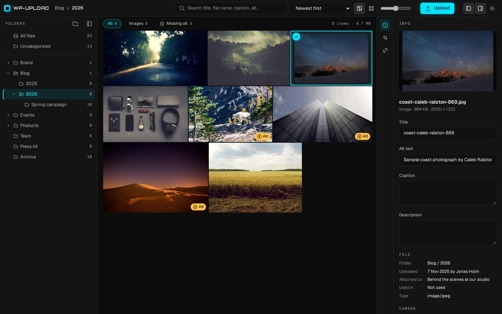 | 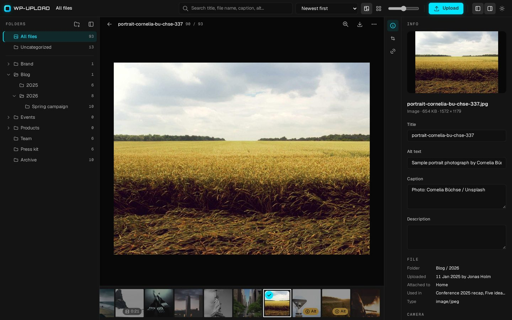 |
| 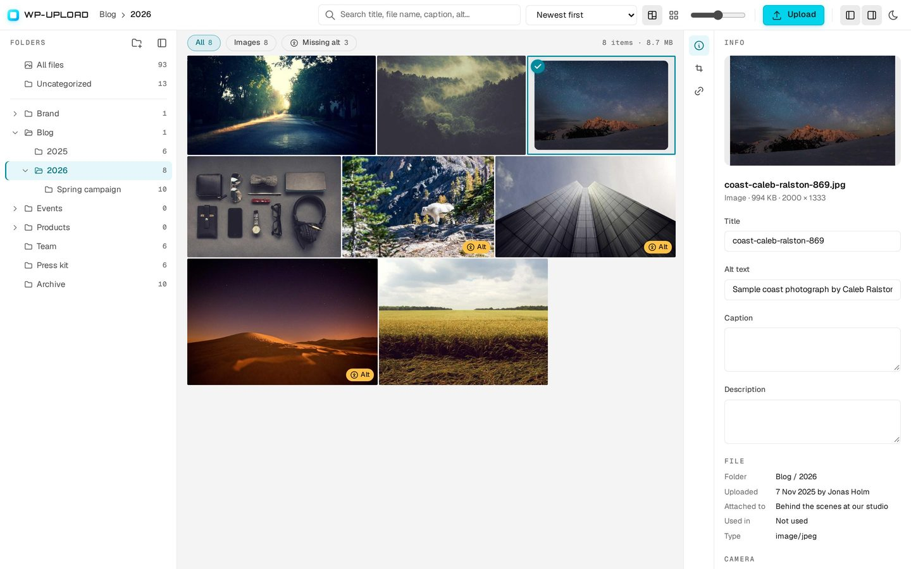 | 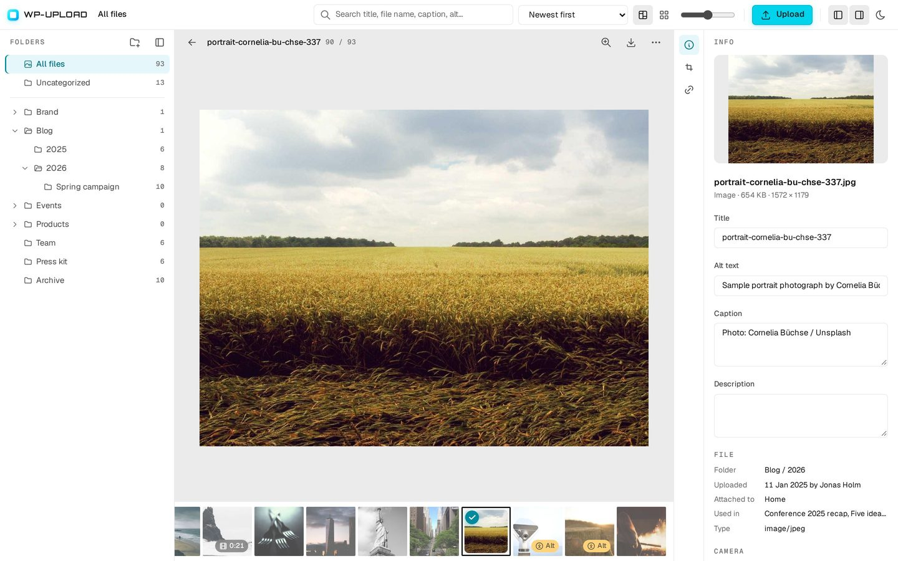 |

### Pro tool

| Grid | Detail |
|---|---|
| 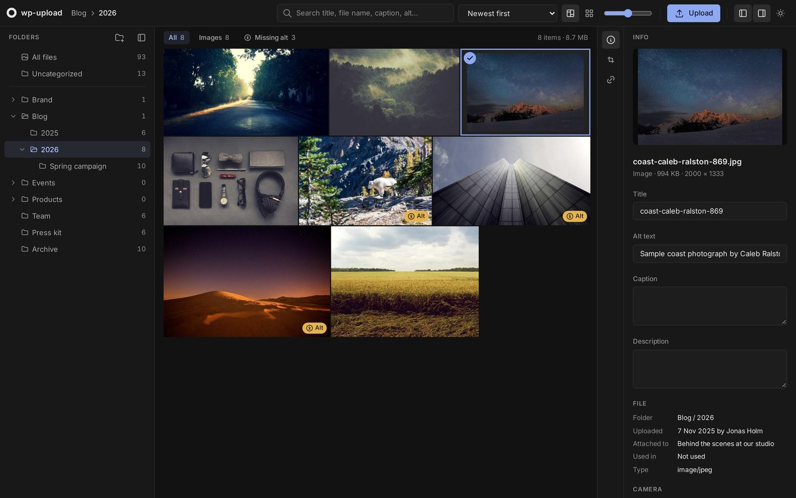 | 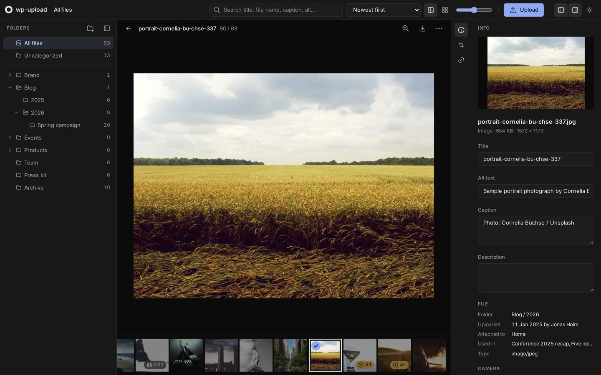 |
| 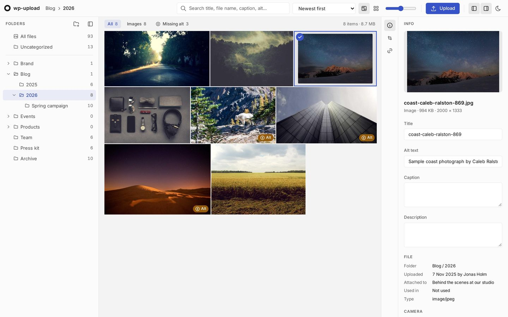 | 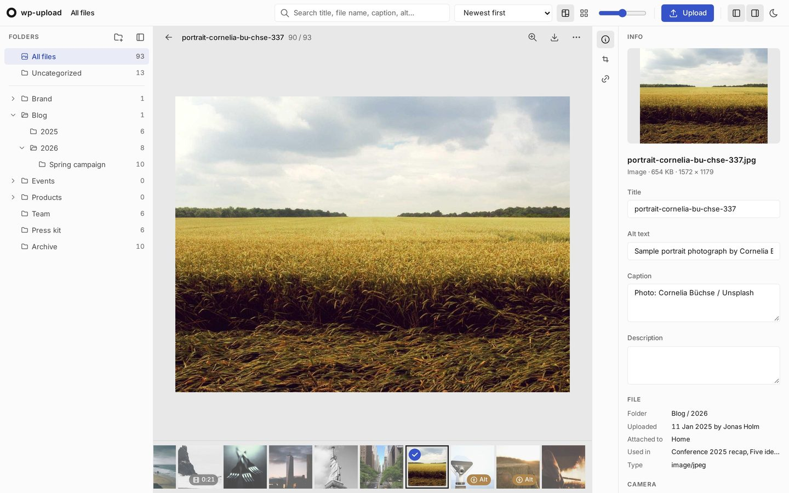 |

### Adapted cyberpunk

| Grid | Detail |
|---|---|
| 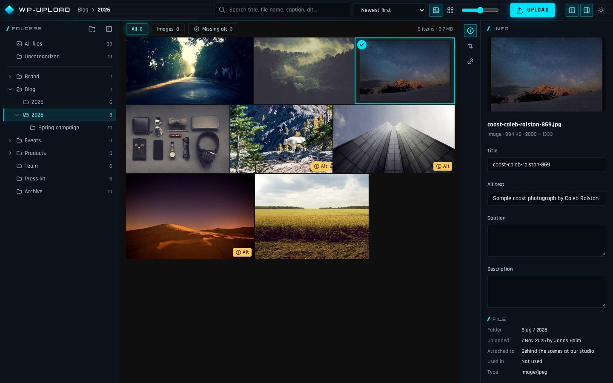 | 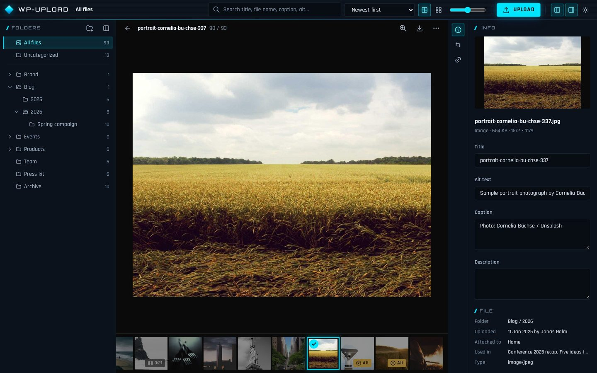 |
| 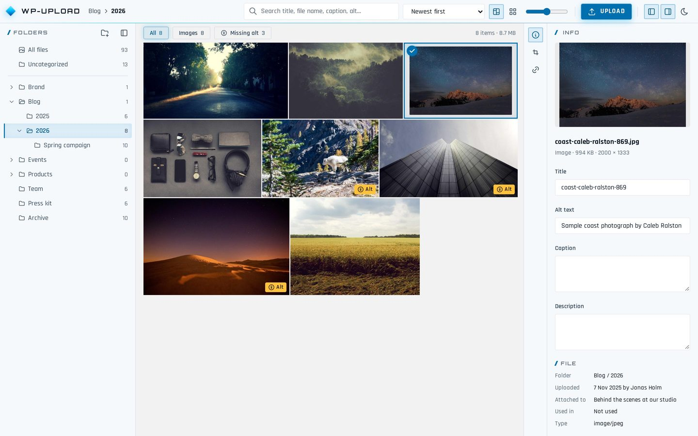 | 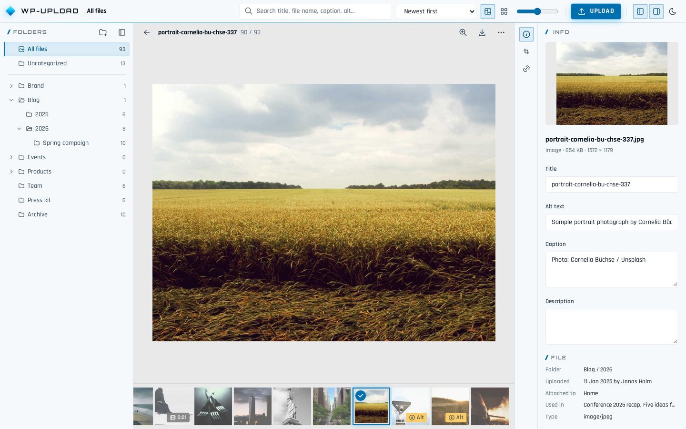 |

## Strengths and risks

| Direction | Strengths | Risks |
|---|---|---|
| **Neutral + neon** | Continuity with today's brand; the photos dominate; neon reads instantly as "selected/active"; Geist Mono labels add character without colour | Neon cyan can feel loud on the light theme (it needs a separate fill and text colour); mono labels are a taste call |
| **Pro tool** | The most image-respectful and least tiring for long sessions; easy to keep consistent; the neutral selection tint never colours a photo | Least distinctive, so it could feel generic; hairline input borders are below 3:1 (WCAG 1.4.11 asks for stronger field edges) |
| **Adapted cyberpunk** | Unmistakably wp-upload; the most "fun"; Orbitron titles give strong hierarchy | Tinted chrome is still in the field of view while judging photos; Rajdhani is narrow at small sizes (needed bigger sizes); glow everywhere risks noise as more UI is added; three web fonts |

## Shared changes the directions asked for (apply in Stage 3 whatever the pick)

These came up in more than one direction, as overrides a skin had to hack around:

1. **Warning tokens:** split `--warn` into `--warn` (text/icon), `--warn-fill` (badge background) and
   `--text-on-warn`. No single light-theme amber passes as both text and fill.
2. **Input focus border:** use `--focus-ring`, not `--accent`. A bright accent fill fails 3:1 as a
   border on white.
3. **Filmstrip states:** "current" and "selected" both use `box-shadow`, so only one shows at a time. They
   need distinct treatments (e.g. an outline for current, an inner ring for selected), plus a
   `--surface-filmstrip` token.
4. **Wordmark and mark:** a dedicated wordmark element and an SVG brand-mark slot, instead of restyling
   `.brand` as a whole.
5. **Input edges:** stronger field borders (≥ 3:1) or a filled field style, for WCAG 1.4.11.
6. **Markup wishes for Stage 4:** middle-truncated file names in the inspector heading, an EXIF summary
   strip, and a stage background switch (black / grey / white) in detail mode.

## Recommendation

**Neutral + neon**, borrowing two details from Pro tool:

- **Why Neutral + neon:** it meets the brief's core rule ("images are the colour") as strictly as Pro
  tool, while keeping the wp-upload identity in the few places a signal is needed: selection, focus and
  primary actions.
- **Borrowed from Pro tool:**
  - its **neutral selection tint**, so no cyan sits behind a selected photo; the ring alone signals
    selection;
  - its **borderless chip/toggle style**, for a quieter toolbar.
- **Why not Cyber:** it is the most fun. But its tinted chrome and glow are what the research warns
  against for a tool used to judge images. It is better kept as an optional "cyber" theme later than as
  the base.

## Decision

**Chosen (Checkpoint 1): Neutral + neon, tweaked.** That is the neutral-neon skin plus two details from
Pro tool:

- a neutral selection cell (ring only, no cyan tint or glow behind a selected photo);
- borderless, squared filter chips.

Stage 3 promotes it into the design system ([design-system.md](design-system.md)), folding in the shared
changes listed above. The other two skins are removed from the prototype; their screenshots stay here for
reference.
