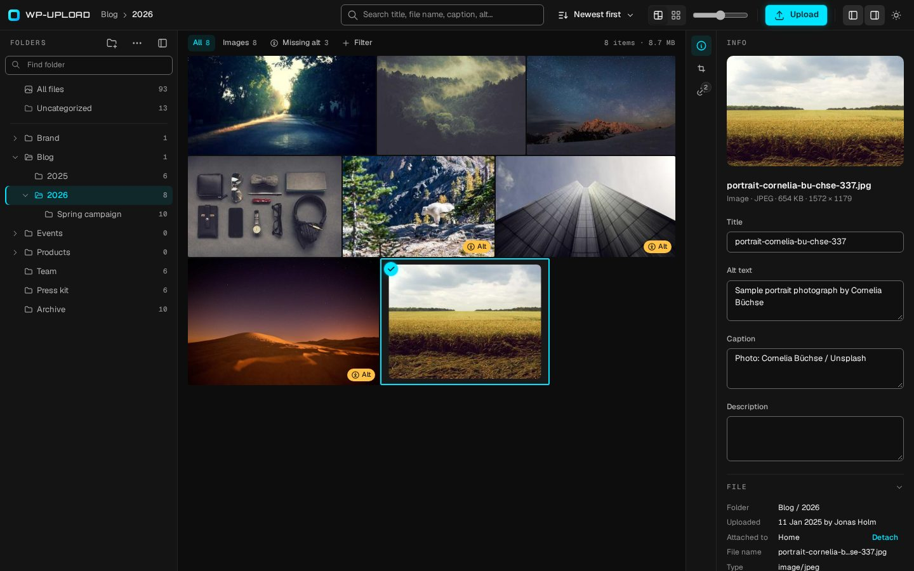
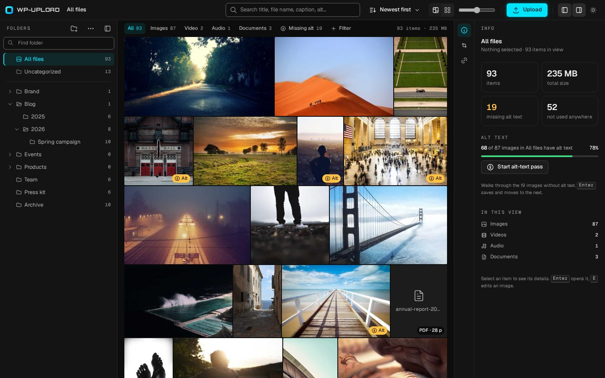
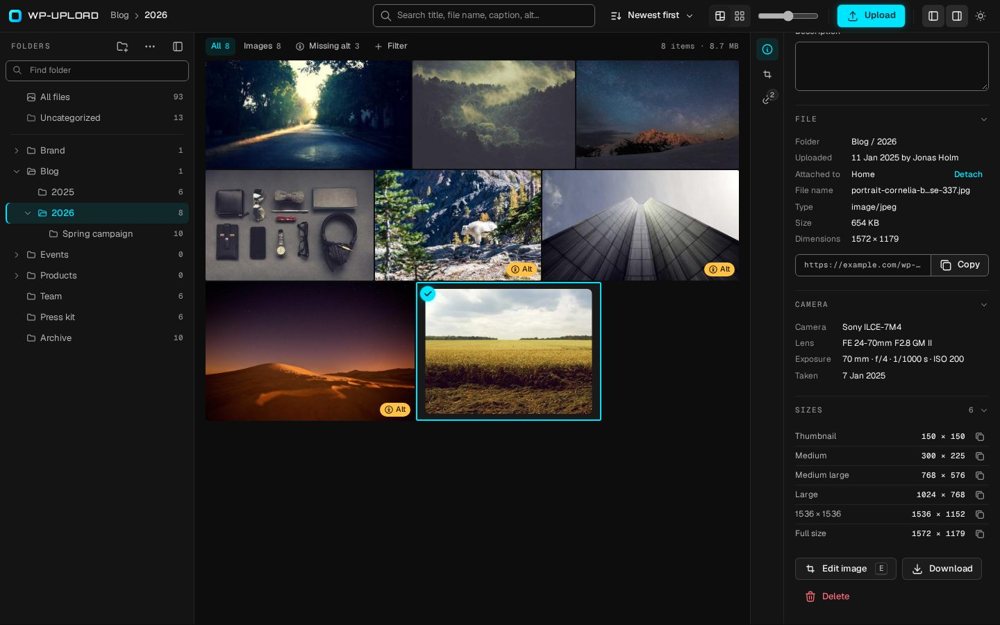
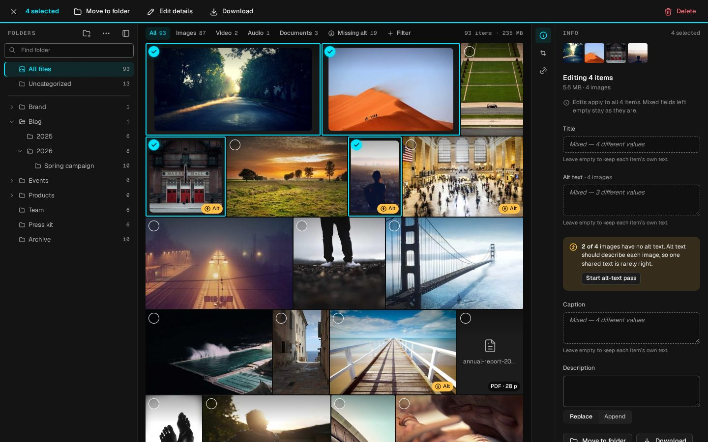
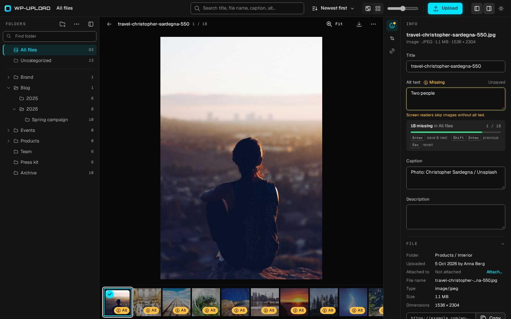
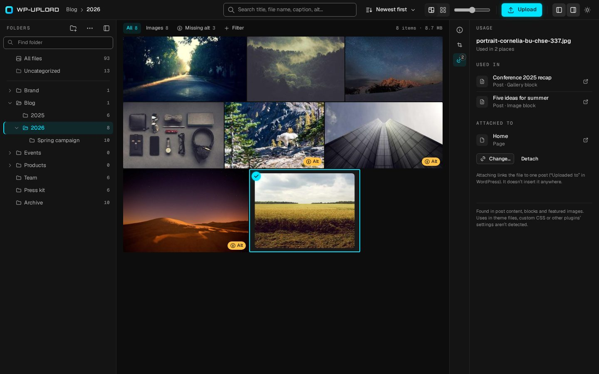
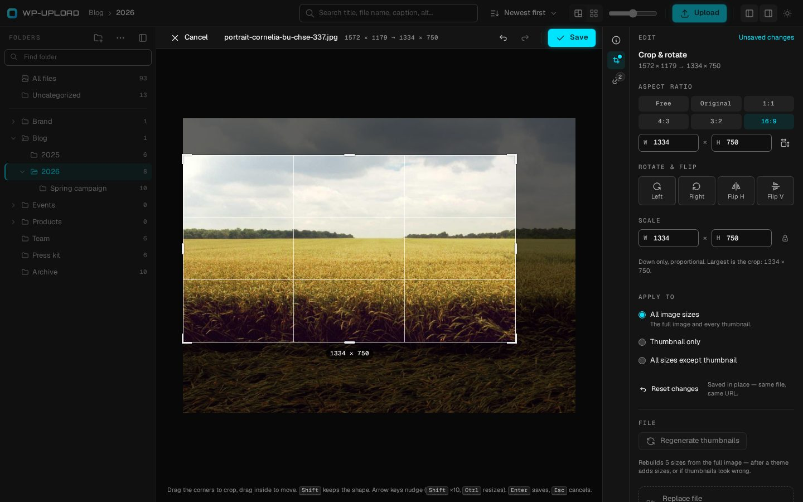
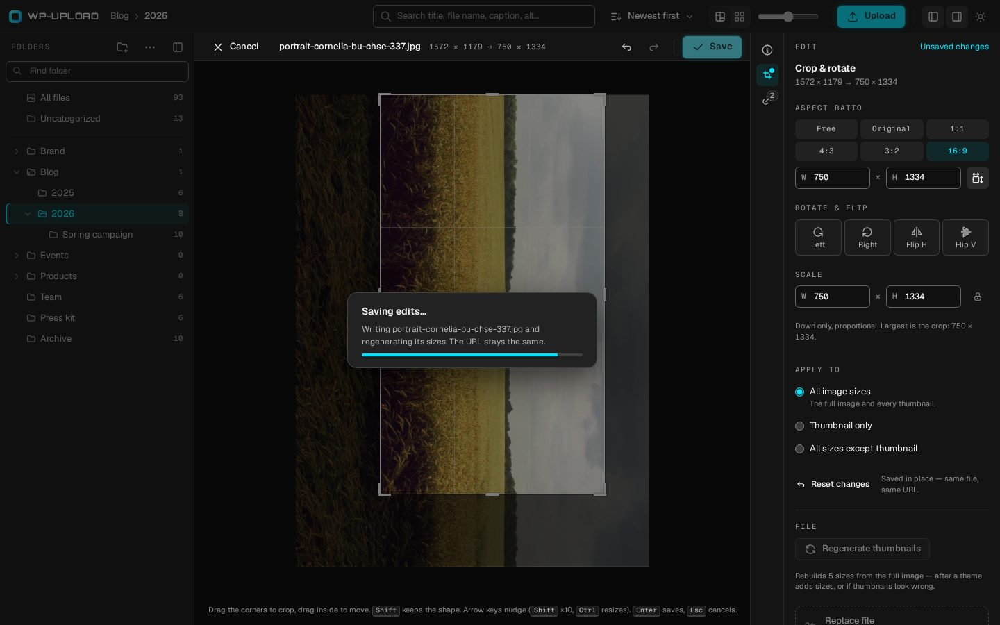
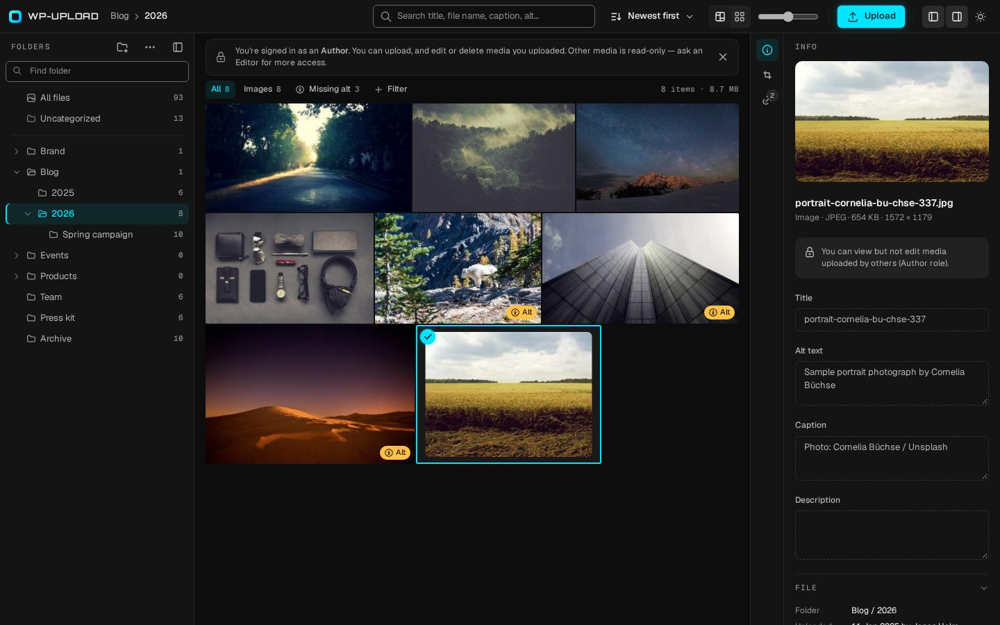

# Spec — Inspector & editing

Screens S4 (inspector), S10 (batch edit, "Save & next"), S11 (image edit in place) and the inspector's part
of S15 (capability-limited states) from the [brief](../brief.md). The prototype is the source of truth for
visuals; this document records behaviour, states, keys and what the companion plugin must provide.

| Prototype file | Content |
|---|---|
| `prototype/js/inspector.js` | Shell: rail, panel slot, rendering (focus, caret and scroll survive re-renders) |
| `prototype/js/features/inspector-info.js` | Info panel for 0 / 1 / N items |
| `prototype/js/features/inspector-autosave.js` | Autosave, field states, "Save & next", batch apply + undo |
| `prototype/js/features/inspector-usage.js` | Usage panel, attach / detach, post picker |
| `prototype/js/features/editor-session.js` | Edit recipe (crop / rotate / flip / scale), geometry, undo / redo |
| `prototype/js/features/editor-overlay.js` | The crop canvas over the centre region |
| `prototype/js/features/editor-panel.js` | Edit panel tools and file maintenance (restore, regenerate, replace) |
| `prototype/js/features/inspector-edit.js` | Feature entry: keys, action bus, edit-session lifecycle |
| `prototype/js/features/inspector-shared.js` | Shared UI state, permissions, sample-data helpers, simulated requests |
| `prototype/css/features/inspector.css` | Everything above that the design system doesn't already cover |
| `scripts/shots/inspector.mjs` | Screenshots (`inspector-*-dark/light`) and interaction checks |

## 1. Structure

One **icon rail** (48 px) and one **panel slot** (312 px), as in Lightroom (cloud). The rail has three tabs:

| Tab | Icon | Key | Content |
|---|---|---|---|
| Info | `info-circle` | `I` toggles the whole inspector (core) | Metadata, file details |
| Edit | `crop` | `E` | In-place image editing and file maintenance |
| Usage | `link` | — | Where used, attached to |

- **Clicking the active tab collapses the panel** to the rail; clicking any tab opens it.
- The rail still talks when collapsed: a **warn dot** on Info when the item lacks alt text, a **count** on
  Usage (number of posts using the item), an **accent dot** on Edit while edits are unsaved.
- The panel header shows the tab name and a short note: "4 selected", "Editing", "Unsaved changes".
- The panel follows the **target**: the selection, or the focused item when nothing is selected
  (`targetItems()`). It is the same in grid and detail mode; in detail mode the Info preview is hidden
  because the stage already shows the image.

## 2. Info panel

### Nothing selected — folder summary

- Heading = the current folder ("All files", "Blog / 2026"), "Nothing selected · 93 items in view".
- Stats: items, total size, **missing alt text** (a button: turns on the Missing alt filter), not used
  anywhere.
- **Alt text coverage**: "68 of 87 images in All files have alt text", a meter and a percentage. When
  anything is missing: **Start alt-text pass** (see §4). When nothing is: "Every image here has alt text ✓".
- Type breakdown of the view (Images / Videos / Audio / Documents with counts).
- Author role: "You can edit 34 of 93 items here — the ones you uploaded."

### One item

Top to bottom:

1. **Preview** (grid mode only), 16:10, `contain` on the stage colour. SVGs on a checkerboard; documents and
   audio as an icon card; video with a play glyph. An "Open" button appears on hover/focus (= `Enter`).
   An "Edited" badge marks images edited in place.
2. **File name**, middle-truncated so the extension stays (full name in the tooltip). Below:
   kind · subtype · size · dimensions (· duration / pages).
3. Read-only notice when the user can't edit the item (§7).
4. **Fields**: Title, Alt text (images and SVG only), Caption, Description. Alt text and Caption are short
   textareas, Description is three lines.
   - Missing alt: amber edge, a "⚠ Missing" flag next to the label (icon + word, not colour only) and the
     hint "Screen readers skip images without alt text."
5. **Collapsible sections** (`
`, state remembered for the session; Sizes starts collapsed):
   - **File**: folder, uploaded on/by, edited on (if edited), **attached to** with Detach / Attach…, file
     name, MIME type, size, dimensions, **original** dimensions with "Copy URL" for `-scaled` uploads (with
     a one-line explanation), and the file URL with **Copy**.
   - **Camera** (only with EXIF): camera, lens, exposure (focal length · aperture · shutter · ISO), date
     taken.
   - **Sizes** (raster images): every generated WordPress size with its dimensions and a copy-URL button,
     then "Full size" / "Full (scaled)". The count shows in the section header.
6. **Actions**: Edit image `E` (images only), Download, Delete (ghost danger; owned by the delete feature
   through the `delete` action).

### Several items — batch editing

- A strip of up to six thumbnails (+N); clicking one selects only that item.
- "**Editing 4 items**" · total size · "4 images, 1 other file".
- The rule, stated once: "Edits apply to all 4 items. Mixed fields left empty stay as they are."
- Fields: Title, Alt text ("· 4 images": alt text applies to image-like items only), Caption,
  Description.
  - A field whose values differ is **Mixed**: dashed edge, italic placeholder "Mixed — 3 different values",
    hint "Leave empty to keep each item's own text". Committing an empty Mixed field changes nothing.
  - Description has **Replace | Append**. Append adds the text as a new paragraph to every description and
    clears the field afterwards.
- When images lack alt text: "2 of 4 images have no alt text. Alt text should describe each image, so one
  shared text is rarely right." + **Start alt-text pass**. Batch alt text stays possible (logos, icon sets)
  but is not encouraged.
- Committing writes all items, shows Saving… → Saved ✓ on the field and a toast
  "**Updated caption on 4 items · Undo**". Undo restores every item's previous value.
- Actions: Move to folder, Download, Delete (bus actions).

## 3. Autosave

There are no Save buttons. A field commits on **blur** and on **Ctrl/Cmd+Enter**; single-line fields
(Title, Alt text) also on **Enter** (Save & next, §4).

| State | Label row (right) | Field |
|---|---|---|
| Unsaved (typing) | "Unsaved" (tertiary) | normal |
| Saving | "Saving…" | normal |
| Saved | "✓ Saved" (ok colour), fades after 1.8 s | normal |
| Error | "⚠ Not saved [Retry]" (danger) | danger edge + hint "Not saved — WordPress didn't respond. Your text is kept here." |

- **Optimistic**: the value is applied locally at commit, so moving on is instant. A failed request puts
  the old value back but **keeps the typed text in the field** with the error state, so Retry has
  something to send. If the user has already moved on (Save & next), a toast says
  "Alt text for "…" wasn't saved · Retry".
- **Esc** in a field with unsaved text **reverts** it (and clears an error); the field keeps focus. A second
  Esc leaves the field and returns focus to the item's tile (the "field → panel → …" layering of brief §7).
- Statuses are keyed by item + field, so they survive the panel re-rendering (selection changes, library
  updates). A half-typed edit is never lost: if the selection changes under it, it is saved to the items
  it was typed for.
- Every save, error and revert is announced through the live region.

## 4. Alt-text pass — "Save & next"

- In the **Title or Alt text** field of a single item, **Enter** saves and moves focus and selection to the
  **next item in the collection** (grid order), with the same field focused and the caret at the end.
  **Shift+Enter** goes to the previous item. Works in grid mode (the tile scrolls into view) and detail
  mode (the stage follows; `?item=` is updated with `replaceState`).
- At either end of the collection the field gives a short nudge and announces "Last item in this view".
- Under the alt field, while it is focused or the item lacks alt text, a strip shows
  **"3 missing in Blog / 2026"**, a coverage meter (current folder, before search/type filters), the
  position "4 / 18" in the view, and the key hints (`Enter` save & next · `Shift Enter` previous · `Esc`
  revert) while focused.
- **Start alt-text pass** (summary or batch panel) turns on the Missing alt filter, selects the first image
  without alt text and focuses its alt field. Each saved item then leaves the filtered view, so the list
  shrinks as you go. With the filter on, Ctrl/Cmd+Enter in alt text also moves on (the item would
  otherwise vanish under the cursor).
- **Finishing**: when the last missing image is saved, the filter switches off (the last item stays
  selected, its field focused) and a toast says "Every image in Blog / 2026 now has alt text — showing all
  files again". It celebrates once per run, not once per save.
- `A` jumps to the alt-text field from anywhere (opens Info if needed; falls back to Title for non-images).

## 5. Usage panel

- **One item**: "Used in 2 places", then a list of posts/pages: title (opens the post), type, and **how it's
  used** (Featured image, Image block, Gallery block, File block…), with an "Edit in WordPress" link.
  Empty: a dashed card "No post or page uses this file."
- **Featured-image warning**: "Featured image of 1 post. Deleting this file clears it there, and that post
  shows no image until a new one is set." (amber notice). The delete feature reuses the same data.
- **Attached to** ("Uploaded to" in wp-admin): the post card, **Change…** / **Detach**, or "Not attached" +
  **Attach to…**. Hint: attaching links the file to one post; it doesn't insert it anywhere.
- **Post picker** (Attach / Change): a menu-styled popover with a search field, arrow keys to move, Enter to
  pick, Esc to close (focus returns to the button). Attach/Detach show a toast with **Undo**.
- **Several items**: "Used in 7 posts · 3 not used anywhere", posts grouped with "2 selected items" counts,
  "N of M attached", **Attach N to…** and **Detach all**.
- **Nothing selected**: used / not-used counts for the view.
- Footnote: "Found in post content, blocks and featured images. Uses in theme files, custom CSS or other
  plugins' settings aren't detected." The index can't be complete; saying so is part of the design.

## 6. Edit panel and the image editor (D7)

### Entering and leaving

- The canvas opens whenever the Edit panel shows **one raster image the user may edit**: `E`, the rail tab,
  "Edit image" in the Info actions or the detail-mode menu (`edit-image` bus action).
- The canvas is an overlay on the **centre region** (`#center`, above grid and detail). The toolbar and the
  folder column fade to 45 % and, with the grid/detail behind the canvas, become `inert`. The inspector
  stays live, because the tools are there.
- **Save** (top bar, `Enter` on the canvas) and **Cancel** (top bar, `Esc`) both return to the panel that
  was open before (usually Info). Leaving with unsaved edits — Cancel, Esc, another rail tab, `I`, `E` —
  asks **"Discard your edits?"** (Keep editing / Discard edits). Unchanged sessions close without asking.
- While editing, app shortcuts that would act on hidden items (arrows, `X`, `Delete`, `G`, `Space`…) are
  swallowed. `F`, `?` and `Tab` pass through.

### The canvas

- The image fitted to the stage with 48 px padding, a **crop box** with L-shaped corner handles, edge bars
  and generous hit areas, the outside dimmed, **rule-of-thirds** lines (faint at rest, clear while
  dragging) and a live "1334 × 750" size pill while dragging or focused.
- Drag inside to move; drag a handle to resize (opposite corner/edge fixed). A ratio is kept when one is
  chosen, or while **Shift** is held. The box can't leave the image or get smaller than 50 px.
- Keyboard: the crop box is focusable. Arrows move it (Shift ×10), **Ctrl/Cmd+arrows resize** it from the
  bottom-right. Steps are screen pixels; history records once the keys go quiet.
- Top bar: Cancel · file name · "1572 × 1179 → 1334 × 750" · **Undo** / **Redo** (`Ctrl/Cmd+Z`,
  `Ctrl/Cmd+Shift+Z` or `Ctrl/Cmd+Y`) · **Save** (primary, disabled until something changed).
- Rotate and flip animate (`--dur-3` / `--dur-2`); under reduced motion the panel and crop moves are
  instant and only the fade-in remains.

### The panel (single editable image)

| Section | Controls |
|---|---|
| Aspect ratio | Free, Original, 1:1, 4:3, 3:2, 16:9 (chips) · W × H crop size fields · orientation swap (portrait/landscape) |
| Rotate & flip | Left, Right, Flip H, Flip V (flips are pressed toggles, neutral) |
| Scale | W × H output size, **always proportional** (lock shown, not a toggle — WordPress can't scale non-proportionally), **down only**, max = crop. Stored as a factor, so it follows the crop |
| Apply to | All image sizes · Thumbnail only · All sizes except thumbnail (wp-admin parity; the chosen option shows its hint) |
| Footer | Reset changes · "Saved in place — same file, same URL." |
| File | Restore original (only when edited) · Regenerate thumbnails · **Replace file** drop zone. Disabled with "Save or cancel your edits first." while there are unsaved edits |

Geometry: rotate and flip work in **screen space** ("Flip H" mirrors what you see), and the crop box rotates
and mirrors with the picture. The full recipe is sent on save; the order is rotate/flip → crop → scale.

### Saving

- Save shows a card on the canvas — "Saving edits… Writing <file> and regenerating its sizes. The URL
  stays the same." — with progress. On success the canvas closes, the item takes its new dimensions, and a
  toast says "**Saved — 6 sizes regenerated · Undo**" ("Thumbnail saved" for thumbnail-only). Undo
  reverts this save (the plugin keeps a backup per edit).
- On failure the card turns into "Couldn't save your edits — WordPress didn't respond. Your changes are
  still here." with **Retry** and **Keep editing**.

### Other states

| Situation | Edit panel |
|---|---|
| Nothing selected | Empty state: "Select an image to crop, rotate, flip or scale it." + the in-place promise |
| Several items | "Crop, rotate and flip work on one image at a time." · **Edit "<first image>"** · **Regenerate thumbnails (N)** for all selected images |
| SVG | Explains it's vector (no pixels, no sizes); Replace file only |
| Video, audio, archive | "Crop, rotate and flip are for images (JPEG, PNG, WebP, AVIF)." Replace file only |
| PDF | Same, plus **Regenerate preview** |
| Not allowed (Author) | Lock notice naming the uploader, tools listed as unavailable |

### File maintenance

- **Restore original**: confirm ("Restore the original image?… The URL stays the same."), progress in
  place, toast "Original restored — thumbnails regenerated".
- **Regenerate thumbnails**: progress "Regenerating sizes… 3 / 6" in place of the button; toast. For N
  items, progress per item.
- **Replace file**: drop a file on the zone or "choose a file". The type must match (JPEG for JPEG) so the
  URL stays the same; otherwise a toast explains. Confirm dialog: "Replace "…"? new.jpg (2.4 MB) replaces
  the current file. The ID and URL stay the same and all sizes are regenerated." + "Used in 2 posts — they
  show the new file right away. The old file can't be brought back." Then upload progress and a toast.

## 7. Permissions (D9)

`?scenario=author` — the user is an Author; items uploaded by others are view-only.

- One item: lock notice "You can view but not edit media uploaded by others (Author role)." Fields become
  `readonly` (not `disabled`: text stays selectable, copyable and reachable by screen readers) with a
  dashed, quiet style. Delete is hidden; Edit image is disabled with a reason; Attach/Detach are hidden.
- Several items: edits apply to the user's own items only — "Changes apply to the 5 items you uploaded. 7
  uploaded by others stay as they are." All foreign: everything read-only.
- Edit panel: lock notice naming the uploader; Usage panel: read-only notice, no attach controls.
- Production reads this per item from `_links.self.targetHints.allow` (PUT/DELETE) and
  `users/me?context=edit`, not from the author name.

## 8. Keyboard

| Key | Where | Action |
|---|---|---|
| `E` | anywhere (not typing) | Open/close the Edit panel (and canvas) |
| `A` | anywhere (not typing) | Jump to alt text (Info opens if needed) |
| `Enter` / `Shift+Enter` | Title or Alt text, one item | Save & next / previous |
| `Enter` | Title / Alt text, several items | Commit to all |
| `Ctrl/Cmd+Enter` | any field | Commit and stay |
| `Esc` | field | Revert unsaved text; again: leave the field |
| `Ctrl/Cmd+Z`, `Ctrl/Cmd+Shift+Z` / `Ctrl/Cmd+Y` | editor | Undo / redo |
| Arrows, `Shift`+arrows, `Ctrl/Cmd`+arrows | crop box focused | Move, move ×10, resize |
| `Enter` / `Esc` | editor (not on a button) | Save / cancel |

All keys are letters, named keys or Ctrl/Cmd+letter, so they work on US and Danish layouts. The bindings
are registered with `registerBindings` and appear in the shortcut sheet (group "Edit").

`E` (`inspector.edit-image`) and `A` (`inspector.focus-alt`) are reserved for the inspector in
`DEFAULT_BINDINGS` and interaction-spec §8 (group "Edit"). The inspector implements `inspector.edit-image`
(it opens or collapses the Edit tab); the image editor (B1) hooks in through `registerEditPanel` and
reports unsaved edits with `setEditUnsaved`.

## 9. Edge cases

- **Selection changes mid-edit**: the typed value is saved to the items it belonged to.
- **Missing alt filter + save**: the item leaves the view; Save & next has already moved on. Ctrl+Enter
  in alt text moves on too. An emptied view switches the filter off.
- **Save & next with a failed save**: the error follows as a toast with Retry.
- **Batch with mixed kinds**: alt text writes images only; the label says how many.
- **Batch with an empty Mixed field**: nothing changes. (Clearing a field on all items is not in v1; it
  would need an explicit "Clear on all" action.)
- **Editor + library change** (an upload finishes): the canvas stays; the panel re-renders around it.
- **`-scaled` uploads**: edits apply to the scaled "full" file (as wp-admin does); the original stays and
  is listed in File.
- **Huge images**: the canvas uses a 1536 px preview; the server applies the recipe to the full file.
- **Clipboard unavailable**: Copy still confirms (prototype); production falls back to selecting the URL
  field.
- **Offline** (`?scenario=offline`): saves fail into the error state; the system feature also locks fields.

## 10. Companion plugin API needs

> **Superseded by the contracts.** The edit body `{rotate, flipH, flipV, crop, scale, applyTo}` is replaced by `EditRequest` (an ordered `ops` list), and the usage shape by `UsageRef`. The binding definitions are in
> [plugin-api.md](../../contracts/plugin-api.md) and [server-api.md](../../contracts/server-api.md); this
> section is kept for the design rationale.

| Need | Proposed route | Notes |
|---|---|---|
| In-place edit | `POST /wp-upload/v1/media/{id}/edit` `{ rotate, flipH, flipV, crop: {x,y,w,h}, scale: {w,h}, applyTo: all\|thumbnail\|nothumb }` | Coordinates in the oriented full image. Overwrites in place (same ID and URL), keeps a backup per edit (`_wp_attachment_backup_sizes`), regenerates sizes, returns the new `media_details` |
| Undo last edit | `POST …/media/{id}/edit/undo` | Restores the previous backup |
| Restore original | `POST …/media/{id}/restore` | Like wp-admin's "Restore original image" |
| Regenerate | `POST …/media/{id}/regenerate` and a batch form `{ ids: [] }` | Rebuild all registered sizes (core's `post-process` only creates missing ones). Progress per item; long jobs need polling (WP processing can take minutes under load) |
| Replace file | `POST …/media/{id}/replace` (multipart) | Same MIME type required; keeps ID, file name and URL; regenerates sizes; purges caches if possible |
| Used in | `GET …/media/{id}/usage` → `[{ post, context: featured\|image-block\|gallery-block\|file-block\|content\|… }]`, and `?ids=` for batch | From the plugin's index; also powers the delete warning |
| Batch metadata | `POST …/media/batch` `{ ids, set: { alt?, caption?, title?, description? }, append?: { description } }` | Or a proxy fan-out with limited concurrency. Returns per-item results so partial failures can be shown |
| Capabilities | `targetHints.allow` per item | Already in core REST |

## 11. Requests to core

1. **Tile rings paint above detail mode.** `.tile::after` has `z-index: 3`, and neither `.grid-scroll` nor
   `.tile` creates a stacking context, so a selected/focused tile's ring shows through `.detail`
   (`z-index: 2`) — visible after Save & next in detail mode (screenshot `inspector-save-next`). Fix:
   `isolation: isolate` on `.grid-scroll` (or `.tile`).
2. **Detail mode doesn't refresh on `library` changes**: after an item leaves the collection (Missing alt
   filter + save) the index ("2 / 19") and filmstrip are stale until the next focus change.
   `syncDetail` should re-render on `library` changes too.
3. **A stacking token for overlays on the centre region** (the editor uses `calc(var(--z-detail) + 1)`),
   e.g. `--z-editor: 3`.
4. **Keymap ownership**: Agent B binds `e` (edit-image) and `a` (focus-alt), group "Edit". Please reserve
   both in the interaction spec.
5. **Inspector DOM injection by the system feature** (`system-states.js`, `system-upload.js`): it
   prepends a read-only notice and locks fields via a MutationObserver. The inspector now renders those
   states itself; its notices carry `mm-readonly` so the injected one is skipped, and the single-item body
   keeps `data-item` for the upload preview. Better: a small hook (e.g. `registerInspectorDecorator`)
   instead of DOM patching.
6. **Window-wide upload drop overlay** should ignore drags over `[data-drop-zone]` (the Replace file zone
   stops propagation in the bubbling phase only).
7. **`registerBindings` group "Edit"** should be listed in the shortcut sheet's group order.
8. A **redo icon** (`arrow-forward-up`) in `icons.svg`; the editor mirrors `arrow-back-up` for now.
